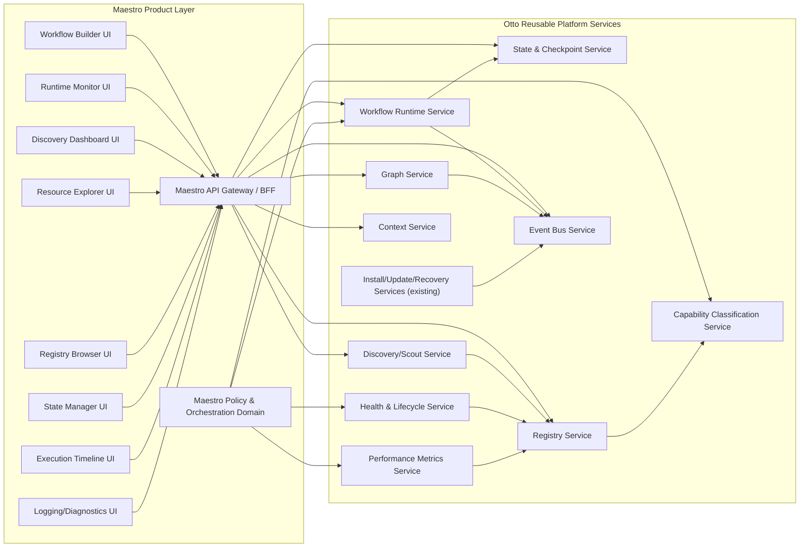
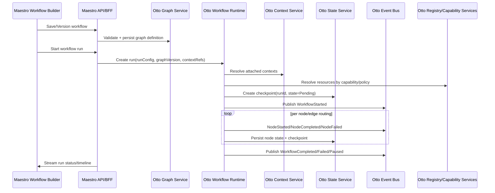
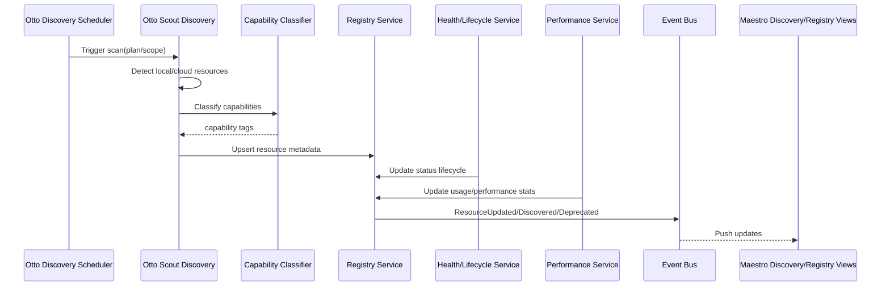

# Maestro Master Architecture & Execution Plan

Status: Draft v1.5 (architecture-first plan + Otto-first contract-core iteration in progress)
Date: 2026-10-17  
Scope: Preserve all completed Otto↔Maestro foundation work and define the next long-range build phases for Maestro as a graph-based orchestration platform on Otto, while progressively formalizing the contract layer for graph, runtime, discovery, and checkpoint services.

## 1) Architecture Overview

### Strategic Positioning

- **Otto** is the reusable platform substrate (install/update/runtime/discovery/registry/state/events/graph/workflow services).
- **Maestro** is the orchestration product surface (workflow authoring, execution operations, visualization, and policy control).
- Existing Otto integration work is **foundational infrastructure**, not disposable tracer work.
- The current repo is still in the contract-and-shell layer. It defines the Maestro orchestration surface and validation metadata, but it does not yet include a standalone browser app or a live UI server to open directly from source.
- The project has now crossed into the first concrete service implementation slice: the graph layer is implemented in-memory and tested against the shared Otto-first contracts; the workflow runtime state machine and checkpoint manager are now in place; the discovery/registry capability classification layer has been implemented as a concrete first pass with resource classification and registry tracking; the next phase adds health/performance-aware ranking and provider selection heuristics so the registry can choose the right resource based on capability, quality, and operational fitness. That phase is now implemented in the registry layer via resource performance snapshots, health records, best-match scoring, and a dedicated `ResourcePolicyRouter` service; the high-level `ProviderRegistry` facade now exposes the best-fit classifying path directly. The next orchestration layer after that is runtime event publication via a workflow event bus so orchestration state transitions become observable and externally subscribed without tightly coupling listeners to the runtime class itself.

### North-Star Objective

Build a deterministic orchestration platform where users define intent and capabilities, while Otto services provide execution, state, discovery, health, and telemetry.

---

## 2) Existing Work to Preserve (Now Treated as Foundation)

The following are accepted as completed/in-progress infrastructure and remain in the target architecture:

- Otto installation and bootstrap flows
- Otto update / package retrieval / repair-healing paths
- Otto runtime monitoring and degraded-mode diagnostics
- Otto module lifecycle integration
- Maestro install/runtime management and dashboards
- Manifest/contract plumbing
- Registry and service wiring between Otto and Maestro
- Conductor/provider-governance observability hardening and diagnostics artifacts

These become **Phase 0 platform baseline** for all future work.

---

## 3) Service Boundary Diagram (Otto vs Maestro)

Boundary rule: business logic stays in Otto services and Maestro domain policy modules; UI remains orchestration/visualization only.

---

## 4) Data Flow Diagrams

## 4.1 Workflow Execution Flow

## 4.2 Continuous Discovery and Registry Update Flow

---

## 5) Otto Module Breakdown (Reusable Services)

| Otto Service | Responsibility | API Surface | Storage | Status |
| --- | --- | --- | --- | --- |
| Install/Update/Recovery | Install, update, repair, healing, runtime bootstrap | Existing Otto command/runtime contracts | Existing Otto manifests/state | **Foundation complete/in-progress** |
| Graph Service | Graph schema, versioning, traversal, query, event propagation metadata | Graph CRUD + query + traversal API | Graph store + version snapshots | New |
| Workflow Runtime Service | Execute graph workflows with routing/retries/approvals | Run lifecycle API + command API + event stream | Run-state store + checkpoints | New |
| State & Checkpoint Service | Save/resume/rollback/snapshot | Checkpoint API + restore API | Checkpoint/event-sourced state store | New |
| Discovery (Scout) Service | Detect ecosystem resources continuously | Scan API + scheduler + change feed | Discovery index + inventory graph | New |
| Registry Service (expanded) | System-of-record for resources & capabilities | Resource metadata/query API | Registry relational store | Expand existing |
| Capability Classification | Taxonomy and capability tagging | Classification API + policy hooks | Classification tables/vectors | New |
| Health & Lifecycle | Installed/missing/broken/deprecated states | Health probe + lifecycle transitions | Health history store | New |
| Performance Metrics | Cost/latency/success/resource utilization | Metrics ingest/query API | Time-series metrics store | New |
| Context Service | Reusable context entities and attachments | Context CRUD + attach/detach API | Context document store + links | New |
| Event Bus | Cross-service async communication | Publish/subscribe contracts | Bus broker + event log | New (platform-level) |

---

## 6) Maestro Module Breakdown (Product Layer)

| Maestro Module | Scope | Depends On |
| --- | --- | --- |
| Workflow Builder | Compose graph workflows visually, validate authoring constraints | Graph Service, Context Service |
| Runtime Monitor | Observe run state transitions and node execution | Workflow Runtime, Event Bus, State Service |
| Discovery Dashboard | Inspect scan results and ecosystem drift | Discovery Service, Registry Service |
| Resource Explorer | Deep resource detail, dependencies, health/perf trends | Registry, Health, Performance |
| Registry Browser | Search/filter resources by capabilities and constraints | Registry + Classification |
| State Manager | Resume/rollback/checkpoint operations | State Service + Runtime Service |
| Execution Timeline | Deterministic timeline/replay of events | Event Bus + State snapshots |
| Diagnostics View | Traces/logs/errors/root-cause links | Existing observability + Event Bus |
| Maestro API/BFF | Stable UI-facing contract adapter | All Otto services |
| Maestro Policy Layer | Product-specific routing/policy preferences | Runtime + Registry + Capability services |

---

## 7) API Contract Recommendations

Use explicit versioned contracts under Otto protocol conventions.

## 7.1 Core API Shapes

- **Graph Service**
  - `POST /graphs`, `GET /graphs/{id}`, `POST /graphs/{id}/versions`
  - `POST /graphs/{id}/query`, `POST /graphs/{id}/traverse`
- **Workflow Runtime**
  - `POST /runs`, `POST /runs/{id}/pause`, `POST /runs/{id}/resume`, `POST /runs/{id}/cancel`
  - `GET /runs/{id}`, `GET /runs/{id}/nodes`
- **State Service**
  - `POST /runs/{id}/checkpoints`, `GET /runs/{id}/checkpoints`
  - `POST /runs/{id}/rollback`, `POST /runs/{id}/restore`
- **Discovery/Scout**
  - `POST /scans`, `GET /scans/{id}`, `GET /inventory/resources`
- **Registry**
  - `GET /resources`, `GET /resources/{id}`, `POST /resources/query`
- **Context**
  - `POST /contexts`, `POST /contexts/{id}/attach`, `GET /contexts/{id}`
- **Events**
  - `GET /events/stream` (SSE/WebSocket) + broker topics

## 7.2 Event Contracts (minimum)

- `WorkflowStarted`, `WorkflowPaused`, `WorkflowCompleted`, `WorkflowFailed`
- `NodeStarted`, `NodeCompleted`, `NodeFailed`, `NodeSkipped`
- `CheckpointCreated`, `CheckpointRestored`, `RollbackExecuted`
- `ScoutDiscoveredResource`, `ResourceUpdated`, `ResourceHealthChanged`
- `CapabilityClassified`, `ResourceDeprecated`, `ResourceMissing`

Include deterministic fields: `eventId`, `eventTime`, `runId`, `graphVersion`, `nodeId`, `correlationId`, `sourceService`, `schemaVersion`.

---

## 8) Storage Recommendations

| Data Domain | Recommended Store | Why |
| --- | --- | --- |
| Graph definitions + versions | Relational + JSON columns (or document DB with relational index) | Strong versioning + query flexibility |
| Runtime state/checkpoints | Append-only event store + checkpoint snapshots | Deterministic replay and recovery |
| Registry metadata | Relational DB | Filtering, joins, dependencies, audit |
| Capability classification | Relational + optional vector index | Structured labels + semantic expansion |
| Performance metrics | Time-series DB | Efficient trend and percentile queries |
| Context objects | Document store + link table | Flexible context payloads with attach refs |
| Event bus durable log | Broker log retention | Replay and operational debugging |

Initial practical default: PostgreSQL (core metadata) + Redis/NATS/Kafka (events) + Prometheus-compatible metrics pipeline. Keep interfaces abstracted behind Otto service contracts.

---

## 9) Technology Stack Recommendation (Graph Service Decision)

## Decision: **Hybrid, phased**

- **Phase A (near-term): TypeScript-first Graph Service**
  - Reuses current Maestro/Otto TypeScript velocity and test harnesses.
  - Fastest path to stable contracts and feature correctness.
- **Phase B (scale path): Optional Rust graph kernel behind same service contract**
  - Introduce Rust for high-volume traversal/layout/execution planning hot paths.
  - Keep API contract stable so Maestro remains unaffected.

### Why hybrid over immediate Rust-only

- Existing codebase and integration/test pipelines are TypeScript-heavy.
- Early architectural risk is contract and domain-shape correctness, not raw traversal throughput.
- Hybrid keeps ETC/DRY/SOLID goals: stable interface, replaceable implementation.

### Recommended implementation posture

- Keep the public Otto service contracts language-agnostic and versioned.
- Use TypeScript service adapters and orchestration logic in the first implementation pass.
- Keep the Rust graph kernel as a pluggable backend when memory pressure, traversals, or layout optimization exceed TypeScript runtime efficiency.
- Do not couple Maestro UI or workflow orchestration directly to the graph engine storage implementation.

---

## 10) Execution Model Recommendations

## 10.1 Workflow Runtime States

- `Pending`
- `Running`
- `Waiting`
- `Paused`
- `Complete`
- `Failed`
- `Cancelled`
- `Skipped`

## 10.2 Routing/Logic Requirements

Support first-class:

- sequential, conditional, branch/merge
- bounded loops and controlled circular workflows
- confidence threshold routing
- retry routing and error routing
- dynamic node selection by capability + policy
- human intervention and approval nodes

## 10.3 Advanced Node Schema (recommended shape)

Each node supports composable subcomponents:

- `agentRef[]`
- `modelRef[]`
- `mcpServerRef[]`
- `toolRef[]`
- `promptRef[]`
- `contextRef[]`
- `conditions[]`
- `routingRules[]`
- `executionPolicy` (`retry`, `timeout`, `fallback`, `approvalRequired`)

Node contract must allow one or many references per resource type.

---

## 11) Prioritized Implementation Roadmap

## Current milestone: Runtime orchestration contract boundary

The shared Otto-first contract layer now includes graph traversal, event-bus publish semantics, discovery lifecycle metadata, capability/resource telemetry contracts, graph persistence/version semantics, and concrete adapter boundaries for both the Graph Service and Workflow Runtime. The next concrete implementation step is to formalize the orchestration policy and execution routing boundary so Maestro can schedule runs, route alternate paths, apply approval/confidence rules, and create/restore checkpoints without drifting into ad hoc runtime logic or standalone CLI/API creation outside the Otto command-service rule.

## Phase 0 — Foundation Lock (already mostly complete)

- Freeze and version current Otto install/update/runtime contracts.
- Publish contract baseline and compatibility matrix.
- Exit criteria: existing install/update/runtime flows remain green.

## Phase 1 — Event Bus + Contract Core

- Introduce platform-wide event bus schemas and publisher/subscriber SDK.
- Normalize deterministic event fields.
- Exit criteria: runtime + discovery + registry events visible end-to-end.
- Current execution status: event envelopes, capability/resource metadata, graph traversal, and persistence/versioning contracts are in the shared platform contract layer and validated by TypeScript checks.

## Phase 2 — Graph Service v1

- Build TypeScript Graph Service with versioned graph persistence and traversal/query APIs.
- Include layout metadata and serializer contracts.
- Exit criteria: Maestro builder can persist/load/query graph versions via service APIs.
- Immediate next milestone: formalize the graph service adapter boundary and first TypeScript implementation contract in the shared platform layer before introducing a concrete runtime implementation or a new Otto ecosystem repo.

## Phase 3 — Workflow Runtime Service v1

- Execute graph nodes with state machine semantics and routing.
- Implement retries, timeouts, alternate/error path routing.
- Exit criteria: deterministic run replay for baseline workflow templates.

## Phase 4 — State & Checkpoint Service v1

- Checkpointing, resume, rollback, and partial restoration.
- Exit criteria: failed workflows can resume from checkpoint without full restart.

## Phase 5 — Discovery/Scout + Registry Expansion

- Continuous discovery scheduler + machine-wide inventory graph.
- Registry expansion for health/version/dependencies/last-seen/capabilities.
- Exit criteria: discovery dashboard reflects live ecosystem changes.

## Phase 6 — Capability Classification + Dynamic Selection

- Capability taxonomy and policy-based resource selection (“best available coding model”).
- Exit criteria: workflow runtime can select resources by capability intent.

## Phase 7 — Health/Performance Intelligence

- Track success/failure/cost/latency/resource metrics.
- Feed recommendation engine and policy guards.
- Exit criteria: policy can route using performance and health signals.

## Phase 8 — Maestro Productization Layer

- Full workflow builder, monitor, timeline, state manager, registry explorer.
- Harden BFF/API surface and multi-tenant readiness.
- Exit criteria: operational beta with governance and diagnostics guardrails.

---

## 12) Migration Path from Tracer-Bullet to Target Platform

1. **Stabilize current contracts** (no breaking changes to Otto integration foundation).
2. **Introduce service façades** in Maestro to call Otto services behind interfaces.
3. **Dual-path period**:
   - existing conductor/runtime paths continue,
   - new Graph/Runtime/State services run in parallel for selected workflows.
4. **Progressive cutover** by capability flag:
   - graph persistence cutover,
   - runtime cutover,
   - checkpoint/resume cutover,
   - discovery/registry intelligence cutover.
5. **Deprecate local-only implementations** once parity + regression thresholds are met.

No “big bang” replacement.

---

## 13) Risks & Technical Challenges

| Risk | Impact | Mitigation |
| --- | --- | --- |
| Service boundary leakage (UI or Maestro owning Otto logic) | High coupling, fragile evolution | Contract governance + review gates |
| Event schema drift | Broken observability/replay | Versioned schemas + compatibility tests |
| Non-deterministic runtime behavior | Unreliable orchestration | Deterministic clocks/IDs + replay tests |
| Discovery false positives/noise | Poor trust in inventory | confidence scoring + source provenance |
| Capability misclassification | Bad dynamic routing | layered taxonomy + human override |
| State/checkpoint corruption | Failed recovery | immutable logs + checksums + rollback tests |
| Performance overhead from service split | Latency increase | async eventing + caching + perf SLOs |
| Premature Rust complexity | Slower delivery | phased TS-first, Rust only for hot paths |

---

## 14) Recommended Next Execution Order (Immediate)

For the next several development phases, execute in this order:

1. Event contract normalization + bus scaffolding
2. Graph Service v1 (TS)
3. Workflow Runtime v1 state machine + routing primitives
4. Checkpoint/Resume v1
5. Discovery continuous scan engine
6. Registry expansion + capability classification
7. Health/performance policy routing
8. Maestro UI surfaces consuming service APIs only

This order minimizes rework and preserves current Otto integration investment.

---

## 15) Governance Rules for Ongoing Work

- Otto-first reusable capability rule: if reusable, it belongs in Otto service layer.
- Maestro remains orchestration UX and product-domain policy layer.
- All new cross-service behavior requires explicit contracts and event schemas.
- Maintain feature-first implementation structure and deterministic testability standards.

---

## 16) Definition of Done for “Master Plan Acceptance”

This plan is considered accepted when:

- Otto/Maestro boundaries are approved and documented.
- API and event contract skeletons are ratified.
- Phase 1–3 delivery backlog is created from this plan.
- Migration flags/cutover checkpoints are defined in implementation tracking docs.

